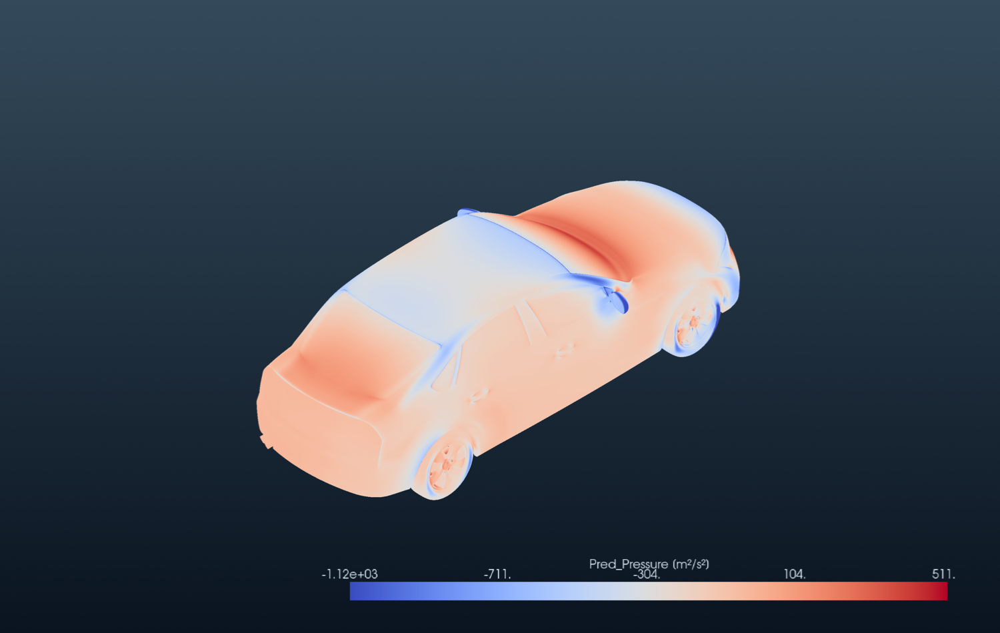
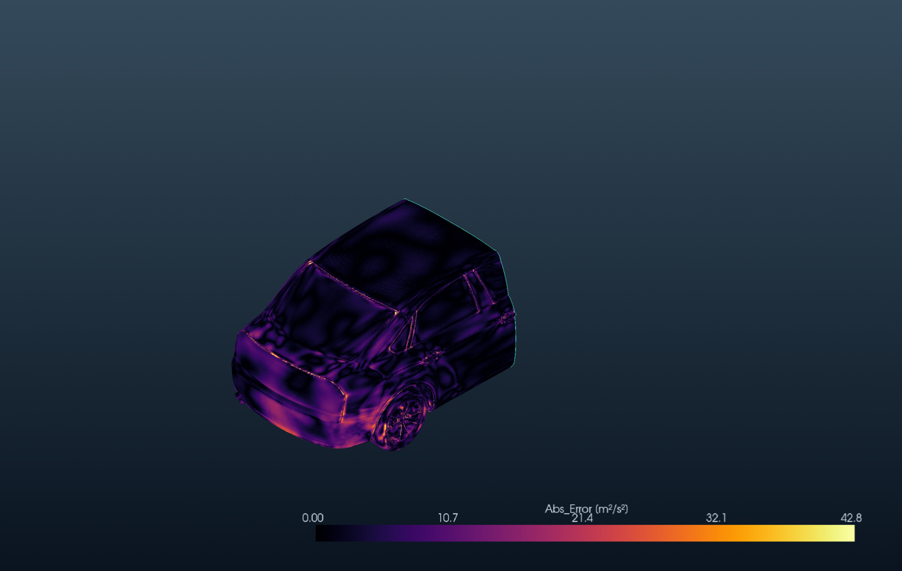
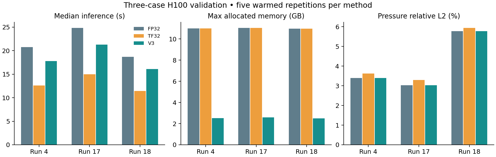

# Memory-Efficient Transolver Inference on DrivAerML with Tiled Attention and CUDA Graphs

**P2I Lab / Power2Idea Lab — Technical Report, draft 2, 27 November 2026**
**Author:** Krishna Srinivasmurthy, independent engineering researcher
**Status:** Engineering reproduction; not peer reviewed. Authorship and release review pending.
**Reproducibility checkpoint:** `checkpoint-2026-11-26-transolver-cuda-v3`

## Abstract

We evaluate memory-efficient inference for NVIDIA's pretrained Transolver surface model on three preselected DrivAerML validation cases, using identical 200,000-cell partitions and unchanged trained weights. Five complete-case repetitions per method on H100 GPUs compare strict FP32 PyTorch, globally TF32-enabled PyTorch and tiled physics-attention with selective TF32 and a shared CUDA graph. The tiled implementation achieves 1.162–1.166× median speedup and 76.6–77.2% lower peak allocated memory versus strict FP32. Its pressure relative L2 errors against time-averaged reference CFD are 3.39417%, 3.02365% and 5.78184%; all pass the predeclared accuracy allowances relative to FP32. Global TF32 is faster but fails those allowances on all three cases. Allocated memory increases across repeated tiled runs, so a fixed persistent-serving footprint is not established. The original run-4 kernel verification includes five scoped zero-error Compute Sanitizer processes. A separate protected Trame/VTK EGL viewer renders the undecimated run-4 surface, with one measured 109.6 ms server-side cutaway update on T4. This engineering study demonstrates an accuracy-constrained memory/performance trade-off, not a new aerodynamic solver or global attention over all cells. Separate controls are still needed to isolate tiling, precision and graph-replay contributions.

## 1. Research question and contribution

Can an existing trained aerodynamic neural operator retain its reference-case prediction quality while reducing inference memory and runtime, and can its results be inspected interactively without downloading the full model to the browser?

Our contribution is an engineering implementation and documented ablation: a failed scalar fusion, a numerically accurate but slower tiled implementation, and a graph-captured selectively reduced-precision implementation that passes a declared case-level accuracy gate. We retain failures in the evidence archive to distinguish measured improvements from architectural speculation. The learning algorithm, checkpoint, CFD dataset and original physics-attention formulation are upstream contributions, not P2I inventions.

The initial cache-oriented design was called “L2-tiled” in development notes. We establish **bounded-memory tiling**, not guaranteed L2 residency. One FP32 tile of 32,768 inputs × 8 heads × 512 slices occupies 512 MiB for a single weight buffer. No V3 L2 hit-rate or Tensor Core saturation measurement is available.

### Related work and scope

Transolver introduced learned physical slices for PDE surrogate modeling [1].
Transolver++ subsequently addressed million-scale geometries and parallel execution
[6]; therefore, million-scale coverage alone is not a new contribution. FlashAttention
[7] established IO-aware tiling for conventional attention. Our implementation uses
recomputed slice weights, library GEMMs and a shared CUDA graph; it does not implement
FlashAttention's fused kernel or demonstrate equivalent IO-optimality. The contribution
here is a measured inference trade-off for an existing NVIDIA checkpoint, not a new
neural-operator architecture or a claim of first million-scale inference.

The DrivAerML source uses SA-sigma-DDES, a hybrid RANS-LES approach, and provides
time-averaged fields [3]. Earlier P2I drafts called these simply RANS fields; this
revision corrects that terminology without changing reference arrays or measurements.

## 2. Model, data and numerical contract

The model is NVIDIA's official `Transolver.0.501.mdlus`, accompanied by `global_stats.json`. It contains 20 layers, eight attention heads, head dimension 32 and 512 learned slices. PhysicsNeMo 2.1.1 loads the checkpoint strictly. Run 4 belongs to the publisher's validation split; this report does not independently audit the training corpus.

| Artifact | Pinned identity |
|---|---|
| NVIDIA model revision | `96477aeb86d24c26ccf0797bca1b3851268017d0` |
| Checkpoint SHA-256 | `eb98f399a050a8f8a24919335c61642e4a835bd4044f7e21abec231aa31fd82c` |
| DrivAerML dataset revision | `5d448b209bf654503c64ce7261c34fa125f46392` |
| NVIDIA CFD wrapper / split commit | `06846c9fbc08b8e82551841897b5294f7e5ef82d` |
| THUML golden-reference commit | `75e0f67643806a81cd1d3f6adc88dd8c02416fe7` |

The reference pipeline centers cell coordinates using the STL cell-center mean, scales coordinates by `[12, 4.5, 3.25]`, and appends unit cell normals. Functional inputs use density 1.205 and speed 30 according to the checkpoint wrapper convention; the reference CFD case speed is 38.889 m/s. Predictions are denormalized with published statistics and the wrapper's `1.205 × 30²` scaling. Comparison uses native `pMeanTrim` and `wallShearStressMeanTrim` arrays; pressure is a kinematic pressure quantity, not automatically pascals. No fitted pressure offset or sign correction is applied.

Inputs are shuffled deterministically with seed 42 and processed in **200,000-cell partitions**, with a final 140,177-cell partition. Each partition independently traverses all 20 layers. All methods preserve this partitioning. Thus full-case coverage does not imply global attention across all 8.14 million cells; changing partitions can change predictions.

## 3. Attention and implementation

For one head, projected geometry features produce logits, and projected functional features provide values. For input index i and slice j:

\[
w_{ij}=\operatorname{softmax}_j(z_{ij}/\tau),\quad
\tau=\operatorname{clamp}(T,0.5,5),\quad
n_j=\sum_i w_{ij},\quad
s_j=\sum_i \left(\frac{w_{ij}}{n_j+0.01}\right)f_i.
\]

Slice self-attention produces updated slice tokens, which are desliced with the original weights and passed through the output projection. The **0.01 epsilon and division-before-aggregation order** are the NVIDIA checkpoint implementation's contract; they must not be substituted with the earlier THUML experiment's constants.

V1 accumulates unnormalized weighted features before dividing. Although algebraically equivalent, floating-point reordering causes unacceptable end-to-end drift. Its scalar aggregation also repeatedly streams data through HBM.

V2 uses GEMMs and a custom vectorized softmax kernel, repeating tile projections in three passes: (1) accumulate global slice norms, (2) normalize weights before weighted aggregation, and (3) deslice after slice attention. Cross-tile norms are FP64. This restores strict Layer 0 equivalence but loses the runtime gate.

V3 retains the three-pass structure with **FP32 cross-tile norm accumulation**, selective TF32-enabled GEMMs, FP32 outer projections and slice self-attention, and a shared CUDA graph. It does **not** use FP64 norms. A single graph and stable parameter/input buffers serve successive layers, with parameter and input copies included in timed inference. Partition-shape changes release the previous graph and capture the new shape, avoiding 20 retained graph pools. The custom CUDA kernel handles softmax and normalization; dense products remain PyTorch/cuBLAS operations. This is not a monolithic FlashAttention kernel.

## 4. Measurement protocol

GPU execution, extension compilation and sanitizer runs occur exclusively on Modal. The benchmark requests `H100!` to avoid automatic GPU substitution. Recorded software is PyTorch 2.10.0+cu128, CUDA 12.8.1 development image, Python 3.12 and PhysicsNeMo 2.1.1. The local Mac orchestrates jobs and formats reports without CUDA execution.

Whole-model timing includes indexing and model forward across every partition. Loading, graph preparation, denormalization, CPU transfer and CFD validation are excluded. The paired baseline disables TF32. Measurements are one warmed complete-case pass per method; confidence intervals and repeated-run variance are not available. Full-model V3 graph preparation adds 175.920 ms, but this is not a complete cold-start measurement.

Memory is reported in decimal MB using PyTorch allocated and reserved counters. Allocated memory is not total process VRAM; CUDA context and other allocations can lie outside these counters. Graph pools retain reusable storage.

For pressure p and prediction p-hat, reported relative L2 is `100 × ||p-hat − p||₂ / ||p||₂`, unweighted over surface cells. Wall-shear error uses the analogous vector norm. These are surrogate-versus-CFD errors, not errors against a physical experiment.

## 5. Ablation results

### 5.1 Complete model, identical case and partitions

| Method | Latency (ms) | Speedup vs paired FP32 | Peak allocated (MB) | Peak reserved (MB) | Pressure relative L2 (%) | Outcome |
|---|---:|---:|---:|---:|---:|---|
| PyTorch FP32, V3 paired baseline | 20,796.695 | 1.000 | 10,992.240 | 11,427.381 | 3.394399 | Reference |
| CUDA V1, scalar fusion | 190,564.713 | — | 2,004.550 | Not recorded | Not recorded | Numerical gate failed |
| CUDA V2, tiled FP32 / FP64 norms | Not run | — | — | — | — | Layer 0 speed gate failed |
| CUDA V3, tiled TF32 / FP32 norms / graph | **17,699.752** | **1.17497** | **2,252.230** | **4,640.997** | **3.394170** | Declared V3 gates passed |

V1's separately measured FP32 baseline was 20,792.189 ms; its speedup against that baseline was 0.109108×. V3's speedup against the rounded historical 20,792 ms reference is 1.174706×. We do not mix the earlier 3A latency, which had a different measurement scope, into this table.

V3 reduces warmed elapsed time by about 14.9%, peak allocated memory by 79.5%, and reserved memory by about 59.4%. The allocated-memory result does not demonstrate a 2.25 GB physical working set.

### 5.2 Layer 0, complete-case coverage

| Method | Latency (ms) | Peak allocated (MB) | Maximum absolute output drift |
|---|---:|---:|---:|
| PyTorch FP32, V2 reference | 893.472 | 10,782.640 | Reference |
| V2 tiled FP32 | 1,337.433 | 2,836.056 | 0.0000217287 |
| V3 graph-captured selective TF32 | 757.919 | 1,023.430 | 0.000749588 |

V2 passes the strict `1e-4` numerical criterion but is slower; full-model Gate 2 was therefore not run. V3 uses the predeclared experimental gate of Layer 0 drift below `1e-3` plus case-level pressure accuracy. This is not a claim that V3 satisfies the original strict FP32 whole-module gate. Layer 0 V3's comparison process reserves 14,424 MB because it also executes the unchanged reference; its allocated counter must not be presented as standalone resident memory.

### 5.3 Traffic diagnosis and physics gate

Nsight Compute's `dram__bytes.sum`, accumulated over the separate V1 full-case profiling pass, attributes **26,506,439,356,416 bytes (26.506 TB)** to the scalar `nv::aggregate` kernel. Total V1 traffic was 34.339 TB, compared with 34.504 TB for the reference. Traffic divided by uninstrumented wall time yields 180.198 versus 1,659.454 GB/s respectively. These are aggregate effective rates, not isolated hardware peak bandwidth. **V2/V3 HBM bandwidth was not measured** and is not inferred from allocated-memory savings.

V3 pressure error changes by −0.000228973 percentage points (−0.00674561% relative to baseline error). It passes both a 0.05 percentage-point and a 0.05%-relative allowance. Wall-shear vector relative L2 changes from 6.266735% to 6.267464%. The tiny pressure decrease is numerical variation, not evidence of a better aerodynamic model.

## 6. Verification and memory safety

The unchanged softmax extension passes the original THUML golden-module check at maximum absolute error 7.45e-8 and the NVIDIA 512-slice clamp/division check at 8.94e-8. Uninstrumented Layer 0 numerical comparison covers every cell. V1's final normalized-model output drift is 0.008220673 and fails its gate.

V3 Compute Sanitizer evidence contains five zero-error processes:

1. Four fresh-process Layer 0 groups collectively cover all 8,140,177 cells, including the irregular tail.
2. One process evaluates all 20 trained layers on the first 200,000-cell and final 140,177-cell partitions.

This is **not** an all-20-layers/all-cells sanitizer run. Sanitizer results establish memory safety for exercised paths, not universal correctness or aerodynamic validity. Instrumented timings are excluded from performance tables.

## 7. Protected visualization

The saved V3 outputs are overlaid on the original undecimated 8,150,920-vertex surface in Trame with headless NVIDIA VTK EGL. Views include PBR geometry, predicted pressure, reference pressure, absolute error, wall-shear magnitude and learned slice labels. Front, side, top and isometric cameras and an X-axis cutaway support inspection. Integer image ratios `[1, 1]` preserve the established remote-view handshake.

The final smoke test, on a T4, reports **0.109632665 s (109.633 ms)** for one server-side cutaway update including rendering, with 1,557 cutter cells. It is not a browser round-trip latency, sustained frame-rate measurement or H100 inference timing. GPU mapper clipping avoids copying the full clipped surface; `vtkPlaneCutter` supplies section lines. Safari inspection was subsequently confirmed complete by the user; this is separate from automated smoke verification.



*Figure 1. Saved surrogate pressure on the complete surface. Default percentile color limits saturate extremes; full-range mode is available. Geometry is not decimated.*



*Figure 2. Surface cutaway. The dataset contains a car boundary surface, not internal vehicle components or a volumetric boundary-layer field.*

Optional Cp rendering explicitly assumes zero reference kinematic pressure and divides by `0.5 × 38.889²`; it is not separately validated Cp. Slice IDs come from reference FP32 block 19, head 0 (167 occupied labels among 512 possible), not from a V3 uncertainty estimator. Labels have no assigned physical semantic meaning.

Protected production-class routing retains session authentication and a 300-second scale-down window. The temporary `modal serve` endpoint requires Modal proxy authentication. Existing engine-viewer admission behavior is retained. No production deployment is part of this checkpoint; rendering consumes saved predictions and does not rerun inference.

## 8. Reproduction and evidence

The [experiment README](../../experiments/transolver_lab/README.md) records commands for each historical gate. From the repository root, with the local environment and Modal authentication configured:

```sh
.venv/bin/modal run experiments/transolver_lab/validate_drivaerml.py
.venv/bin/modal run --detach experiments/transolver_lab/publication_benchmark.py
.venv/bin/modal serve --timeout 900 ops/modal_private_viewer.py
```

The README also supplies the original V3 sanitizer/gate command, EGL smoke test,
local report formatter and authenticated preview procedure. The detached publication
job reuses completed five-sample configurations; use a new output namespace whenever
the measurement protocol or implementation changes.

Data, checkpoint and predictions persist in Modal volume `p2i-transolver-drivaerml`. The preview procedure and token handling are documented in the README. Stop its local serve process and run `modal app stop APP_ID --yes` when finished; inspect `modal container list` to confirm no active containers. Persistent volumes remain billable storage even when compute stops.

| Evidence | Purpose |
|---|---|
| [V3 JSON](../../experiments/transolver_lab/evidence/v3-results.json) | Paired measurements and accuracy gates |
| [V3 sanitizer log](../../experiments/transolver_lab/evidence/v3-memcheck.log) | Five scoped zero-error processes |
| [V2 gate](../../experiments/transolver_lab/evidence/v2-gate.json) | Numerical pass / speed failure |
| [V1 benchmark](../../experiments/transolver_lab/evidence/drivaer-cuda-benchmark.json) | Failed fusion and whole-case traffic |
| [Kernel traffic breakdown](../../experiments/transolver_lab/evidence/hbm-kernel-breakdown.json) | 26.506 TB aggregation attribution |
| [Data provenance](../../experiments/transolver_lab/evidence/drivaer-provenance.json) | Source identities and acquisition |
| [EGL smoke JSON](../../experiments/transolver_lab/evidence/viewer/aero-smoke.json) | Render GPU, geometry and cut timing |
| [V3 implementation](../../experiments/transolver_lab/tiled_attention_v3.py) | Exact arithmetic and graph behavior |

Raw profiler logs, failed attempts and earlier reference results remain in the evidence directory. The V3 baseline's descriptive variant label was corrected after execution; numerical measurements were unchanged. Downloaded model/data assets are not redistributed by this source checkpoint; their original terms and attribution obligations remain applicable. Vendored THUML code retains its license.

## Publication validation: three cases and repeated measurements

Cases 4, 17 and 18 were selected from the pinned publisher validation split before
examining their predictions. Each method ran in a fresh process, five sequential
complete-case repetitions; execution order was rotated between cases. All used
the same checkpoint, seed 42 and 200,000-cell partition convention. Original V3
CUDA code was unchanged. This follow-up reuses the earlier scoped sanitizer evidence;
it does not claim additional sanitizer coverage on cases 17 and 18.

| Case | Method | Median ms [min, max], n=5 | Peak allocated / reserved MB | Pressure L2 % | 0.05 pp gate |
|---|---|---:|---:|---:|---|
| 4 | fp32 | 20737.5 [20733.6, 20761.3] | 10992.2 / 11427.4 | 3.394399 | Pass |
| 4 | tf32 | 12614.9 [12612.1, 12617.4] | 10992.2 / 11427.4 | 3.626330 | Fail |
| 4 | v3 | 17805.0 [17759.3, 17815.4] | 2529.8 / 5008.0 | 3.394170 | Pass |
| 17 | fp32 | 24843.4 [24842.1, 24844.7] | 11042.1 / 11530.1 | 3.024468 | Pass |
| 17 | tf32 | 15009.3 [15004.8, 15014.4] | 11042.1 / 11530.1 | 3.289615 | Fail |
| 17 | v3 | 21305.2 [21211.3, 21313.1] | 2578.9 / 4972.3 | 3.023651 | Pass |
| 18 | fp32 | 18710.1 [18709.3, 18713.5] | 10966.6 / 11360.3 | 5.782420 | Pass |
| 18 | tf32 | 11461.5 [11460.5, 11463.1] | 10966.6 / 11360.3 | 5.943229 | Fail |
| 18 | v3 | 16094.8 [16034.6, 16110.2] | 2504.2 / 4930.4 | 5.781841 | Pass |

Memory columns use the maximum over all five repetitions, including graph-pool
behavior across repeated runs. They must not be replaced by the smaller first-pass
numbers. These runs test repeatability within each method process. A disconnected job was
resumed in a second H100 allocation, retaining completed configurations; hardware
identity across that boundary was not recorded. This is not a systematic
cross-host variability study. Per-repetition measurements and standard deviations
are available in the accompanying JSON files.

Globally enabling TF32 is a distinct accuracy/performance trade-off, not automatically
a valid replacement under the declared pressure gate. A same-selective-precision,
non-tiled implementation and separate graph-only control remain untested; the
present evidence cannot isolate the speed contribution of each optimization.

Across cases 4, 17 and 18, V3 achieves 1.162–1.166× median speedup versus strict FP32 and 76.6–77.2% lower peak allocated memory using the worst of five repetitions. All three V3 pressure comparisons pass both the 0.05 percentage-point and 0.05%-relative gates. Globally TF32-enabled PyTorch is faster on every case but fails both pressure gates on each case. This is an accuracy-constrained memory/performance result, not a claim of unconditional fastest inference.

V3 allocated peaks increase over the five repetitions (run 4: 2,252 to 2,530 MB; run 17: 2,302 to 2,579 MB; run 18: 2,227 to 2,504 MB). We have not established whether that growth plateaus. Consequently, no long-running service memory bound is claimed. The tiled intermediate dimensions are bounded, but repeated-process allocator behavior needs separate investigation.



*Figure 3. Measured inference time, maximum allocated memory and pressure error. The faster globally TF32-enabled reference does not meet the predeclared pressure-error allowance.*

The complete geometry sizes are run 4: 8,150,920 vertices / 8,140,177 cells; run 17: 9,705,704 vertices / 9,680,746 cells; run 18: 7,320,829 vertices / 7,315,999 cells.

Follow-up evidence: [raw samples](../../experiments/transolver_lab/evidence/publication/results.json), [summary](../../experiments/transolver_lab/evidence/publication/summary.json), and [preselected-case provenance](../../experiments/transolver_lab/evidence/publication/provenance.json).

## 9. Limitations and publication readiness

The original checkpoint establishes a single-case result; the publication follow-up adds two preselected cases and repeated timing measurements. It does not establish novelty relative to all tiled-attention literature, robust generalization, improved CFD accuracy, multi-GPU scalability, training support, or total cloud cost savings. The follow-up adds globally TF32-enabled PyTorch, repeated warmed timings and multiple publisher-held-out geometries. Remaining evaluation includes cold starts, a non-tiled implementation with exactly the same selective precision, integrated aerodynamic forces, V3 HBM profiling, persistent-serving memory behavior and total job billing. Without those controls, the gain cannot be attributed separately to tiling, graph replay and TF32.

The existing unchanged-FP32 baseline is a useful reproduction reference but not necessarily the fastest available PyTorch implementation. The present ablation is sequential engineering development, not a factorial experiment. The measured memory/accuracy trade-off is a defensible outreach result when the comparison scope and repeated-run memory behavior accompany it. No endorsement or collaboration by NVIDIA or the dataset authors is implied.

## References

1. Wu et al. **Transolver: A Fast Transformer Solver for PDEs on General Geometries.** [arXiv:2402.02366](https://arxiv.org/abs/2402.02366). [Official implementation](https://github.com/thuml/Transolver).
2. NVIDIA. **Pretrained Transolver DrivAerML surface model.** [Model and checkpoint](https://huggingface.co/nvidia/transolver_drivaerml).
3. **DrivAerML.** [Dataset](https://huggingface.co/datasets/neashton/drivaerml); [paper, arXiv:2408.11969](https://arxiv.org/abs/2408.11969).
4. NVIDIA. [Pinned inference wrapper](https://github.com/NVIDIA/physicsnemo-cfd/blob/06846c9fbc08b8e82551841897b5294f7e5ef82d/physicsnemo/cfd/evaluation/models/wrappers/transolver/wrapper.py) and [validation split](https://github.com/NVIDIA/physicsnemo-cfd/blob/06846c9fbc08b8e82551841897b5294f7e5ef82d/workflows/benchmarking/drivaer_ml_files/validation.csv).
5. P2I Lab. [V3 experiment report](../checkpoints/2026-11-26-transolver-3b-v3.md) and [protected-viewer verification](../checkpoints/2026-11-26-transolver-step4-viewer.md), 26 November 2026.

6. Luo, H., Wu, H., Zhou, H., Xing, L., Di, Y., Wang, J., and Long, M. **Transolver++: An Accurate Neural Solver for PDEs on Million-Scale Geometries.** ICML 2025. [arXiv:2502.02414](https://arxiv.org/abs/2502.02414).
7. Dao, T., Fu, D. Y., Ermon, S., Rudra, A., and Re, C. **FlashAttention: Fast and Memory-Efficient Exact Attention with IO-Awareness.** 2022. [arXiv:2205.14135](https://arxiv.org/abs/2205.14135).

## Author and AI-assistance statement

OpenAI Codex assisted source implementation, debugging, remote experiment orchestration
and manuscript preparation. The named human author is responsible for final scientific
review, citations, authorship and submission. Measured results are preserved as executed
GPU evidence. This is an independent P2I Lab report; no upstream endorsement is implied.
